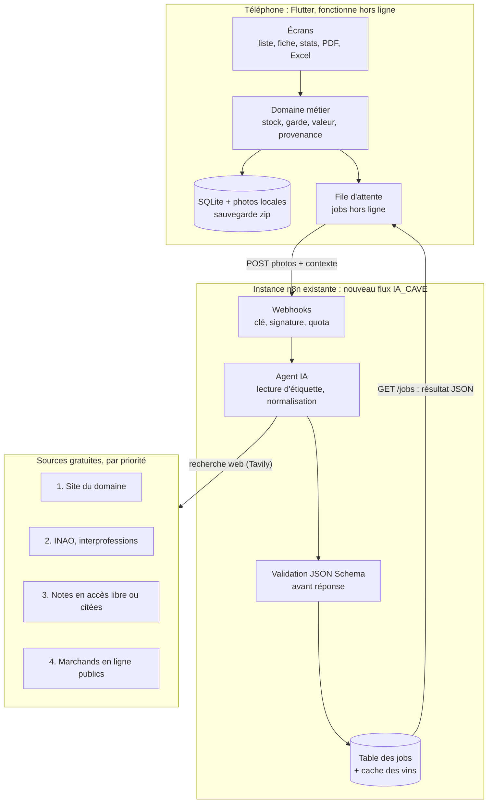
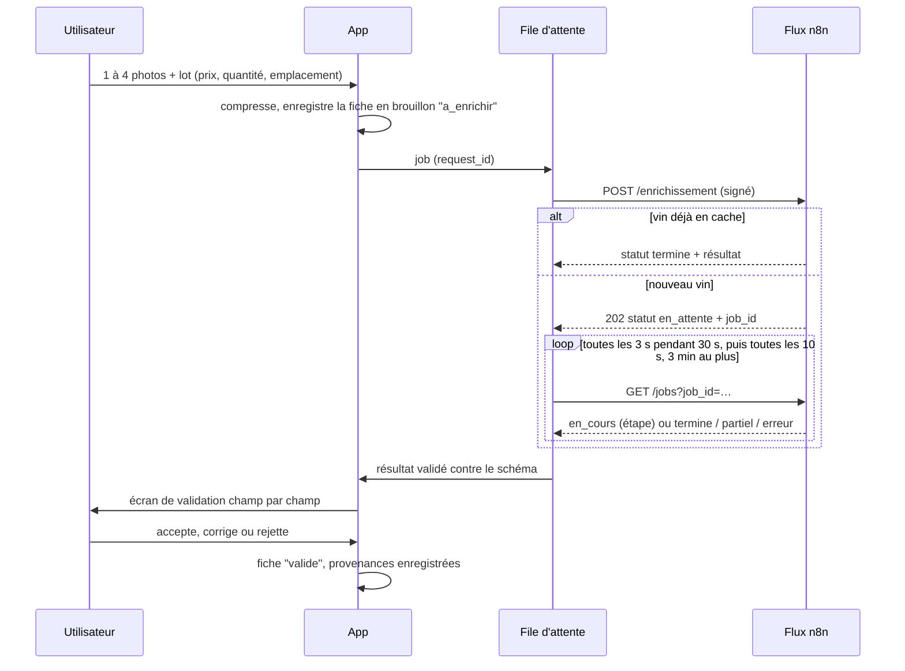
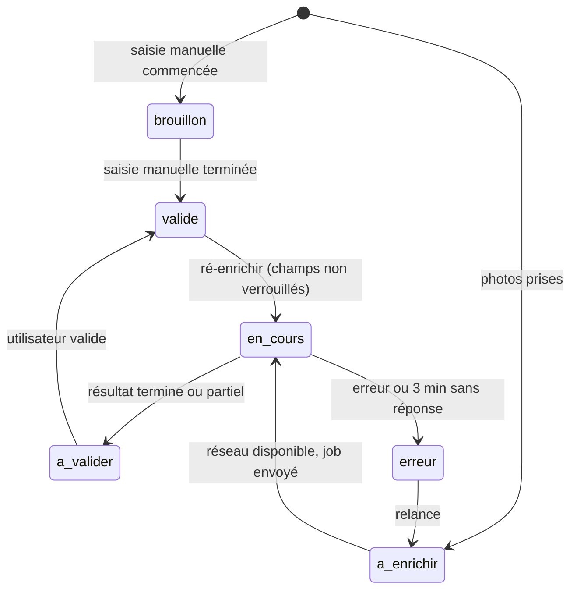

# 02. Architecture et stack

## Vue d'ensemble

La cave vit sur le téléphone. Le flux n8n ne sert qu'à enrichir une fiche et à relever des prix, de façon asynchrone.



## Stack

Flutter (Dart) pour Android puis iOS. Une autre stack n'est acceptable qu'avec une justification écrite dans docs/decisions.md sur quatre critères : fluidité de listes longues, PDF et Excel générés hors ligne, accès caméra, coût du portage iOS.

Bibliothèques indicatives, à confirmer au lot 0 (version stable la plus récente, maintenue, compatible Android et iOS) :

| Besoin | Brique indicative | Exigence |
| --- | --- | --- |
| Base locale | drift (SQLite) | migrations versionnées et testées, index sur tous les champs de tri et de filtre |
| État | Riverpod | providers testables sans widget |
| Navigation | go_router | lien profond `iacaveavin://fiche/<id>` (QR code des PDF) |
| Photos | camera, image_picker, image (compression) | répertoire privé de l'app, aucune permission de stockage étendue |
| Code-barres | mobile_scanner | EAN-13 |
| Graphiques | fl_chart | jetons de specs/design-tokens.json, libellés traduits |
| PDF | pdf, printing | génération hors ligne en isolate |
| Excel | excel | 5 000 lignes sans figer l'interface (isolate) |
| Tâches de fond | workmanager | reprise de la file d'attente au retour du réseau |
| Notifications | flutter_local_notifications | apogée, fin d'enrichissement |
| Secrets | flutter_secure_storage | clé du flux n8n (Keystore Android, Keychain iOS) |
| Validation du contrat | json_schema | les réponses n8n sont validées contre specs/contrat-n8n/ |
| Traductions | flutter_localizations, fichiers ARB | aucun texte en dur dans les widgets |

## Organisation du code

```
app/
  lib/
    core/            thème (généré depuis specs/design-tokens.json), l10n, erreurs, utilitaires
    data/
      db/            tables drift, migrations, DAO
      files/         stockage et compression des photos, archives de sauvegarde
      enrichment/    EnrichmentGateway, N8nGateway, FakeGateway, file d'attente
    domain/          entités, règles de calcul (stock, garde, valeur), cas d'usage
    features/        un dossier par écran : liste, fiche, ajout, stock, emplacements,
                     proprietaires, prix, stats, pdf, excel, parametrage, sauvegarde
  test/              tests unitaires et widgets, nommés par identifiant d'exigence
  integration_test/  parcours complets
  assets/
    referentiels/    listes initiales (pays, régions, appellations, cépages, formats)
    regles/          copie de specs/regles-garde.yaml embarquée
```

Le domaine ne dépend ni de Flutter ni de n8n. L'appel au flux passe par une interface :

```dart
abstract class EnrichmentGateway {
  Future<JobReponse> demanderEnrichissement(RequeteEnrichissement requete);
  Future<JobReponse> demanderPrix(RequetePrix requete);
  Future<JobReponse> suivreJob(String jobId);
  Future<SanteFlux> sante();
}
```

Deux implémentations : `N8nGateway` (HTTP réel) et `FakeGateway`, qui rejoue les fichiers de specs/contrat-n8n/exemples/ avec des délais simulés. Le lot 2a se développe entièrement contre `FakeGateway`.

## Parcours d'un enrichissement



## Cycle de vie d'une fiche



## Sécurité des appels au flux

Phase 1, app non publiée : une clé secrète unique, générée côté n8n, saisie une fois dans les Réglages de l'app (ou scannée en QR code) et rangée dans le stockage sécurisé. Elle n'est jamais dans l'APK ni dans le dépôt.

Chaque requête porte trois en-têtes :

| En-tête | Contenu |
| --- | --- |
| X-IACAV-Installation | UUID de l'installation, généré au premier lancement |
| X-IACAV-Horodatage | secondes Unix |
| X-IACAV-Signature | hex(HMAC-SHA256(clé, horodatage + "\n" + méthode + "\n" + chemin + "\n" + sha256_hex(corps))) |

Le chemin signé est celui de l'URL après l'hôte, chaîne de requête comprise : `/webhook/iacave/jobs?job_id=…` pour le suivi. Un GET a un corps vide, dont l'empreinte est le sha256 de zéro octet. Le vecteur de test est dans `specs/contrat-n8n/vecteur-signature.json`.

Le flux refuse une requête à plus de 300 secondes d'écart, une signature fausse, ou un request_id déjà traité (il renvoie alors le job existant). Révocation : changer la clé côté n8n. Le jour d'une publication, ce schéma cède la place aux comptes (docs/10-evolutions.md).

## Volumes et stockage

Ordres de grandeur à mesurer au lot 0, puis à afficher dans les Réglages :

| Élément | Taille visée |
| --- | --- |
| Photo stockée (1 600 px côté long, JPEG qualité 80) | 250 à 400 Ko |
| Miniature (320 px) | 20 Ko environ |
| Photo envoyée au flux (1 500 px, qualité 80) | 300 Ko environ, 2 Mo au plus |
| Fiche moyenne (2 photos + miniatures) | 0,7 Mo environ |
| Cave de 500 fiches | 350 Mo environ, dont l'essentiel en photos |

D'où deux options dans la sauvegarde : archive complète, ou archive sans photos (quelques Mo, à faire plus souvent).
