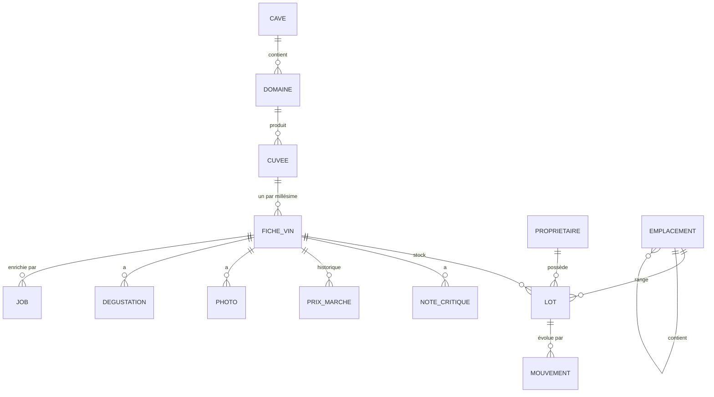

# 04. Modèle de données et règles de calcul

Le détail champ par champ est dans specs/dictionnaire-donnees.yaml, source unique de vérité. Ce document donne la structure, les règles de calcul et leurs cas de test.

## Structure

`PROVENANCE` (origine de chaque valeur enrichie), `VALEUR_LISTE` (listes déroulantes) et `VUE_STATISTIQUE` (favoris de l'explorateur) sont transverses.

Pourquoi l'origine (pays, région, appellation) est sur la cuvée et non sur le domaine : un négociant produit dans plusieurs appellations, parfois plusieurs régions.

Toutes les tables portent id (UUID v4), cave_id, created_at, updated_at, deleted_at.

## Stock

- STK-R1. Quantité d'un lot = somme de ses mouvements. Jamais de champ quantité modifié directement.
- STK-R2. Une quantité de lot ne devient jamais négative : le mouvement qui la rendrait négative est refusé avec un message.
- STK-R3. Stock d'une fiche = somme de ses lots. Bouteilles consommées = somme des mouvements « ouverture », en valeur absolue.
- STK-R4. Un mouvement est immuable. Une erreur se corrige par un mouvement inverse (ou l'annulation de 5 secondes, qui supprime le mouvement tant qu'il n'est pas confirmé).
- STK-R5. Transfert d'une partie d'un lot : création d'un lot cible et de deux mouvements liés (transfert_sortant, transfert_entrant).

## Garde

Champs : garde_debut, garde_apogee (facultatif), garde_fin, en années.

Origine de la fenêtre, par priorité : note critique avec fenêtre, puis domaine, puis marchand qui cite un critique, puis estimation locale par specs/regles-garde.yaml. L'agent n'estime jamais une garde : sans source, il renvoie une valeur nulle et l'app applique ses règles, de façon déterministe et hors ligne.

Statut, évalué dans cet ordre pour l'année en cours A (premier cas vrai) :

1. garde_debut ou garde_fin absent : `inconnu`
2. A > garde_fin : `passe`
3. A < garde_debut : `trop_jeune`
4. A ≥ garde_fin − 1 : `a_boire_vite`
5. garde_apogee présent et |A − garde_apogee| ≤ 1 : `apogee`
6. sinon : `a_boire`

Cas de test obligatoires (garde 2026, apogée 2029, fin 2032) :

| Année | Statut attendu |
| --- | --- |
| 2025 | trop_jeune |
| 2026 | a_boire |
| 2027 | a_boire |
| 2028 | apogee |
| 2030 | apogee |
| 2031 | a_boire_vite |
| 2032 | a_boire_vite |
| 2033 | passe |

Sans apogée (garde 2026, fin 2032) : 2029 donne a_boire. Fenêtre d'un an (2026 à 2026) : 2025 trop_jeune, 2026 a_boire_vite, 2027 passe.

Années avant de boire = max(0, garde_debut − A). Année de consommation idéale = garde_apogee, sinon le milieu de la fenêtre arrondi à l'année inférieure.

## Notes

- NOT-R1. Note Parker affichée = la plus récente des notes de critique « Robert Parker Wine Advocate ».
- NOT-R2. Meilleure note = maximum des notes ramenées sur 100 (une note sur 20 est multipliée par 5 pour la comparaison, jamais pour l'affichage).
- NOT-R3. Une note « citée » (reprise par un domaine ou un marchand) garde le nom du site qui la cite. Elle s'affiche avec ce site.
- NOT-R4. Tri par note Parker : les vins sans note Parker passent en fin de liste, quel que soit le sens du tri.

## Valeur

- VAL-R1. Valeur d'achat = somme des quantités × prix d'achat unitaire des lots. Un lot sans prix d'achat est compté à part (« n bouteilles sans prix »), jamais à zéro.
- VAL-R2. Valeur marché = somme des quantités × dernier prix marché trouvé pour le même format. Pas d'extrapolation d'un format à l'autre.
- VAL-R3. Plus-value latente = valeur marché − valeur d'achat, calculée uniquement sur les lots qui ont les deux.

## Provenance et verrouillage

- PRV-R1. Toute valeur proposée par l'agent crée une ligne de provenance au statut `propose`.
- PRV-R2. L'utilisateur accepte (`valide`), corrige (`manuel`) ou rejette (`rejete`). Un champ `manuel` est automatiquement `verrouille` et figure dans `champs_verrouilles` des ré-enrichissements.
- PRV-R3. Déverrouiller un champ est une action explicite sur la fiche (appui long sur le champ).
- PRV-R4. « Signaler une erreur » sur une valeur enrichie passe `signale` à vrai, la valeur reste affichée barrée jusqu'à correction, et le signalement est joint au prochain appel du flux pour améliorer le cache.

## Référentiels initiaux

Embarqués dans app/assets/referentiels/, chargés au premier lancement, puis modifiables dans le Paramétrage :

| Liste | Source à utiliser |
| --- | --- |
| Pays | ISO 3166-1 (code alpha-2, nom français) |
| Régions, sous-régions, appellations françaises | données ouvertes de l'INAO publiées sur data.gouv.fr ; vérifier la licence et la date du jeu au lot 0, citer la source dans la notice |
| Appellations étrangères | liste courte des principales, complétée à l'usage |
| Cépages | liste d'environ 150 cépages, complétée à l'usage |
| Formats, couleurs, signes de qualité, classements, motifs | valeurs de specs/dictionnaire-donnees.yaml |

## Migrations

Chaque changement de schéma est une migration drift numérotée, avec un test qui part d'une base de la version précédente remplie du jeu de démonstration et vérifie qu'aucune donnée n'est perdue.
