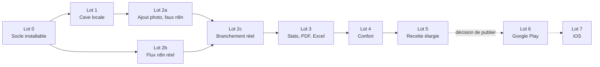

# 08. Lots, recette et définition de terminé

Neuf lots. Un lot démarre quand le précédent est recetté par Bertrand, sauf le flux n8n (2b) qui avance en parallèle dès que le contrat est figé. La cave locale passe avant l'enrichissement : elle doit être utile même si le flux est arrêté.

## Contenu et critères de sortie

| Lot | Contenu | Critère de sortie (recette par Bertrand) |
| --- | --- | --- |
| 0 Socle | projet Flutter dans app/, thème généré depuis specs/design-tokens.json avec test de contraste, navigation (NAV-01), base drift alignée sur le dictionnaire (test d'alignement) et cadre de migrations, jeu de démonstration (CMP-07), écran liste en lecture sur la démo, CI GitHub Actions (analyse, tests, build), keystore et APK signé publié en release GitHub, scripts/matrice_exigences.py, référentiels initiaux dans app/assets/referentiels/ | APK installé sur le téléphone de Bertrand ; liste des 200 vins de démo fluide ; couleurs Apexus validées à l'écran |
| 1 Cave locale | LST, FIC (sauf FIC-09), STK, EMP (sauf EMP-03), PRO, PRX-01, PAR, SAV | 50 vins réels saisis à la main ; archive restaurée sur un autre téléphone sans perte ; stock juste après 30 mouvements variés |
| 2a Ajout photo côté app | AJO-01 à AJO-12 contre `FakeGateway`, provenance et verrouillage (PRV-R1 à R4), FIC-06 à FIC-09, file d'attente hors ligne, garde estimée localement | parcours photo complet en mode avion puis au retour du réseau, avec les 7 exemples du contrat rejoués |
| 2b Flux n8n | flux IA_CAVE_Agent et sous-flux, tables, cache, quotas, sécurité, prompts, sources vérifiées dans n8n/sources-autorisees.yaml, script du jeu d'essai | jeu de 30 étiquettes aux cibles de docs/06-agent-n8n.md ; coût moyen d'un enrichissement mesuré et noté dans docs/decisions.md |
| 2c Branchement réel | `N8nGateway`, réglages de connexion (PAR-05), PRX-02 à PRX-06 | 20 bouteilles réelles ajoutées par photo en moins de 30 s de saisie active chacune |
| 3 Restitution | STA, PDF, XLS | aller-retour Excel de 500 lignes sans écart ; catalogue de 200 fiches en moins de 30 s ; 5 vues de l'explorateur vérifiées à la main contre la liste filtrée |
| 4 Confort | CMP-01 à CMP-07, EMP-03 | usage normal pendant 2 semaines sans blocage |
| 5 Recette élargie | APK distribué à 3 à 5 proches, corrections, NFR mesurées sur 5 000 fiches | 4 semaines d'usage, aucun bug bloquant ouvert, décision écrite de publier ou non |
| 6 Google Play | après décision : compte développeur, fiche store, Data safety, test fermé, production (docs/09-distribution-publication.md) | app en production |
| 7 iOS | portage, revue Apple | app sur l'App Store |

## Définition de terminé (pour chaque exigence)

- [ ] Le code est sur la branche du lot, `flutter analyze` sans avertissement, `dart format` appliqué.
- [ ] Au moins un test porte l'identifiant de l'exigence et passe.
- [ ] Les états vide, chargement, erreur et hors ligne de l'écran sont traités.
- [ ] Aucun texte en dur, aucune couleur en dur.
- [ ] Le dictionnaire, le contrat et les docs sont à jour si l'exigence les touche.
- [ ] docs/journal-lots.md complété.

## Recette transverse (avant de clore le lot 5)

- [ ] Un vin courant photographié est enregistré avec domaine, appellation, millésime et couleur justes, en ne saisissant que prix, quantité, emplacement et propriétaire.
- [ ] Aucune valeur enrichie sans source consultable en un tap.
- [ ] Un champ modifié à la main n'est jamais écrasé par un ré-enrichissement.
- [ ] Le stock affiché égale toujours la somme des mouvements.
- [ ] En mode avion, liste, fiche, stock, statistiques, PDF et Excel fonctionnent ; l'ajout par photo crée une fiche à enrichir.
- [ ] Tris par millésime, couleur et note Parker conformes, vins sans note Parker en fin de liste.
- [ ] La simulation d'import Excel donne un rapport exact ; un import en erreur ne modifie rien.
- [ ] Le catalogue PDF tient 2 fiches par page et rappelle les filtres en page de garde.
- [ ] Aucune clé technique (type « wine_0 ») n'apparaît à l'écran ni dans un export.
- [ ] Une archive restaurée sur un autre téléphone redonne fiches, lots, mouvements et photos à l'identique.
- [ ] Toutes les paires de couleurs du thème passent le contraste WCAG AA.
- [ ] Aucune note critique ni aucun prix sans URL vérifiable dans la base.
